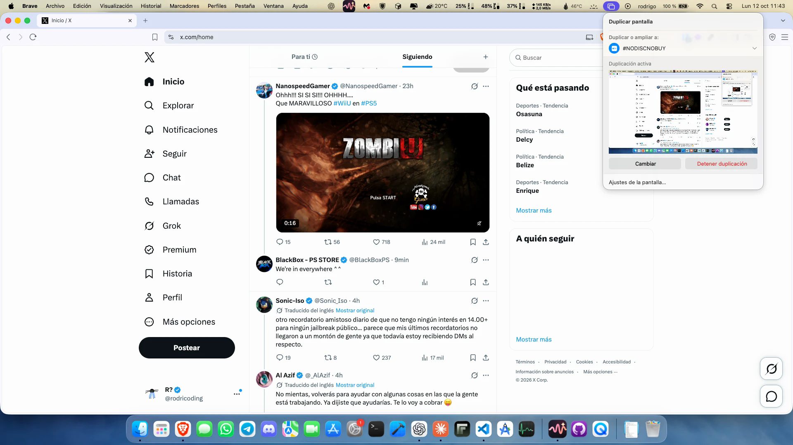

<p align="center">
  
</p>

# PS5 AirPlay

An AirPlay screen-mirroring receiver for jailbroken PS5 consoles. Mirror an iPhone, iPad or Mac to the TV the console is plugged into, with sound, from the home screen or on top of a game.

It runs as a payload: no package to install, no firmware to modify.

https://github.com/user-attachments/assets/6a3c0855-d9c1-421c-8dd3-5f5688562d38

<p align="center"><sub>An iPhone playing Instagram Reels, recorded with the console's own capture.</sub></p>

<p align="center">
  
</p>
<p align="center"><sub>A Mac mirroring its desktop: the receiver shows up in Screen Mirroring like an Apple TV.</sub></p>

## What it does

| | |
|---|---|
| Video | H.264 (Baseline, Main, High), up to 1920×1080 at 60 fps. Decoded in software with FFmpeg. |
| Audio | AAC-ELD, 44.1 kHz stereo (what iOS and macOS send while mirroring). |
| Output | 1920×1080. The picture keeps its proportions; a phone held upright is shown upright with bars at the sides. |
| Pairing | Transient pairing, or a four-digit passcode asked once per device (SRP-6a, like an Apple TV). |
| Discovery | Bonjour (`_airplay._tcp`), answered by the receiver itself. |

Not supported: HEVC, 4K, HDR, DRM-protected video (it stays black, as on any mirroring receiver), AirPlay video casting (the "play on TV" button inside apps), audio-only AirPlay, photos, and AirPlay 2 multi-room.

## Install

You need a jailbroken PS5 running an ELF loader on port 9021 (for example [ps5-payload-elfldr](https://github.com/ps5-payload-dev/elfldr), which etaHEN includes).

1. Download `airplay-installer.elf` from the [latest release](https://github.com/rodri0x/ps5-airplay/releases/latest).
2. Send it to the console:

   ```sh
   socat -t 99999999 - TCP:<ps5-ip>:9021 < airplay-installer.elf
   ```

3. Open **PS5 AirPlay** from the home screen once. That starts the receiver.

On the iPhone: Control Center → Screen Mirroring → pick the console.

The installer adds the home-screen shortcut and copies the receiver to `/data/ps5-airplay`. The receiver does not start on boot; open the shortcut after each restart of the console.

## Settings

The shortcut opens a settings page:

- **AirPlay**: turns discovery and connections on or off.
- **Name**: the name shown in Screen Mirroring.
- **Passcode**: four digits. A device is asked for it the first time it connects; changing it unpairs every device.
- **Mode**: how far behind the sender the picture and sound are played.

| Mode | Delay | Use |
|---|---|---|
| Quality | 200 ms | Watching video. Hides Wi-Fi hiccups. |
| Balanced | 120 ms | Default. |
| Performance | 60 ms | Menus and presenting. May stutter on a busy network. |

At start the receiver shows a notification with its version and whether a newer release exists.

## How it works

```
sender ──mDNS──▶ mdns.c          advertises _airplay._tcp
       ──RTSP──▶ rtsp.c          pairing, FairPlay handshake, SETUP, TEARDOWN (TCP 7000)
       ──TCP───▶ airplay_mirror.c    AES-128-CTR video stream
       ──UDP───▶ airplay_audio.c     AES-128-CBC audio packets
                    │
                    ▼
        h264_decoder.cpp (FFmpeg)        audio_decoder.cpp (FDK AAC)
                    │                              │
                    ▼                              ▼
        ps5_video.c (sceVideoOut)        display_host.c (sceAudioOut)
```

- **Pairing.** `pair-setup` and `pair-verify` use Ed25519 and X25519 (TweetNaCl). With a passcode, `pair-setup-pin` runs SRP-6a in Apple's variant: SHA-1, the RFC 5054 2048-bit group, a 16-byte salt and a 40-byte session key, followed by an AES-128-GCM key exchange. The SRP, SHA-1 and GCM code is in `src/airplay_srp.c`, with no external dependency.
- **FairPlay.** The `fp-setup` handshake (SAP v1) uses the `playfair` code from UxPlay.
- **Timing.** Frames and sound are played at the sender's timestamp plus the delay of the selected mode, not on arrival. Over Wi-Fi packets arrive in bursts; scheduling by timestamp keeps the sender's rhythm, and one shared delay keeps picture and sound together.
- **Video output.** Frames are converted to BGRA straight into the console's tiled scan-out layout (512×128 tiles, a row of tiles being one display width wide) and flipped on vsync from a dedicated thread.
- **Outside games.** The PS5 interface covers a background process's picture and mutes its sound. While a session is active the receiver starts a small app (`display_host.c`) that takes the foreground and plays the audio, and closes it when the session ends. It is launched with the technique of [websrv](https://github.com/ps5-payload-dev/websrv)'s homebrew loader, and creates `/system_ex/app/AIRP00002` the first time.
- **Rest mode.** The console drops TCP listeners when it suspends; the receiver notices and reopens them.

## Build

Requirements: [ps5-payload-sdk](https://github.com/ps5-payload-dev/sdk), LLVM 18, Python 3 and GNU make.

```sh
make PS5_PAYLOAD_SDK=/opt/ps5-payload-sdk
```

This produces `dist/airplay-installer.elf`, which contains the receiver (`build/ps5airplay.elf`), the settings page and the icon.

```sh
make test                                 # host tests (needs the Python package "cryptography")
make deploy PS5_HOST=<ps5-ip>             # build and send the installer
make probes                               # diagnostic payloads, see below
```

A release is published by pushing a tag that matches the `VERSION` file:

```sh
git tag v$(cat VERSION) && git push origin v$(cat VERSION)
```

## Logs

The receiver writes `/data/ps5-airplay/receiver.log` (and keeps the previous session in `receiver.previous.log`). `build/receiver_log_probe.elf` sends both over TCP port 18194 to the first client that connects, then exits:

```sh
socat -t 99999999 - TCP:<ps5-ip>:9021 < build/receiver_log_probe.elf
nc <ps5-ip> 18194
```

While mirroring, the log reports every ten seconds how many frames were decoded, shown and dropped, and how late packets arrived.

## Known limits

- Tested on one console and one home network, with iOS and macOS senders.
- With a game suspended in the background, mirroring from the home screen shows nothing: starting the helper app would close the game.
- Inside a game there is no sound, because the helper app is not running.
- All consoles announce the same device ID, so two receivers on one network will conflict.
- The update check does not verify TLS certificates. It only produces a notification.

## Third-party code

| Component | Use | License |
|---|---|---|
| [FFmpeg](https://ffmpeg.org) 6.0, prebuilt in `third_party/ffmpeg` | H.264 decoder | LGPL 2.1+ |
| [FDK AAC](https://android.googlesource.com/platform/external/aac/) | AAC-ELD decoder | Fraunhofer FDK AAC license |
| [ALAC](https://github.com/macosforge/alac) | ALAC decoder | Apache 2.0 |
| [TweetNaCl](https://tweetnacl.cr.yp.to) | Ed25519, X25519, SHA-512 | Public domain |
| [tiny-AES-c](https://github.com/kokke/tiny-AES-c) | AES-128 | Unlicense |
| playfair, from [UxPlay](https://github.com/FDH2/UxPlay) | FairPlay handshake | GPLv3 |
| `pt.c`, `elfldr.c` from [websrv](https://github.com/ps5-payload-dev/websrv) | Running the helper app | GPLv3 |
| Tile table from [ps5-payload-dev/SDL](https://github.com/ps5-payload-dev/SDL) | Scan-out layout | zlib |

The protocol behaviour follows [UxPlay](https://github.com/FDH2/UxPlay) and RPiPlay.

## License

GPLv3, see [LICENSE](LICENSE). Not affiliated with Apple or Sony. AirPlay is a trademark of Apple Inc.
